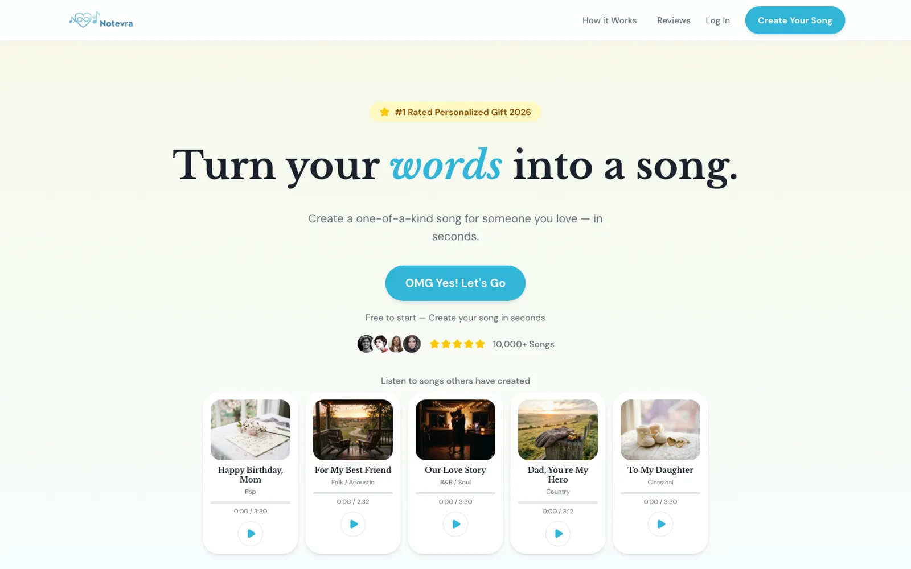
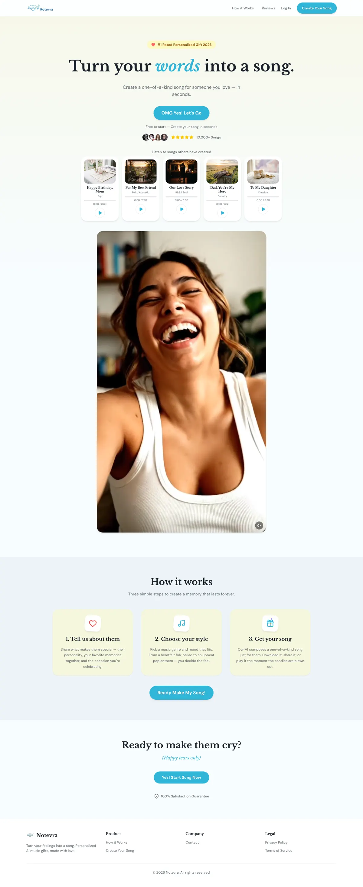

<div align="center">

# Notevra

Turn a few words about someone you love into an original song, written and composed by AI, and send it as a gift.



</div>

---

## Features

- **Guided quiz**: a short quiz about the recipient becomes lyrics, written by Gemini 2.5 Flash
- **AI composition**: the HeartMuLa music model on RunPod Serverless turns lyrics into a full song in Pop, Folk, R&B, Country, or Classical
- **Share pages**: every song gets a listen page, and creator and recipient get it by email
- **Subscriptions**: Starter, Pro, and Unlimited tiers with a token balance

## Stack

| Layer | Tech |
|---|---|
| Frontend | Next.js 16, React, Tailwind, Framer Motion |
| Data & auth | Supabase Auth, Postgres via Drizzle |
| AI | Gemini (lyrics), HeartMuLa on RunPod (music) |
| Storage | Cloudflare R2 |
| Billing & infra | Stripe, Resend, PostHog, Vercel |

## Running it

```bash
cp .env.local.example .env.local   # fill in your own keys
npm install
npm run dev
```

## Status

Notevra was built in 2026 and is no longer live. The code is published here as a portfolio project. Read the case study at [diegofill.com/projects/notevra](https://diegofill.com/projects/notevra).

<details>
<summary>Full landing page</summary>



</details>

## License

MIT. See [LICENSE](LICENSE).

---

Built by [Diego Fill](https://diegofill.com).
